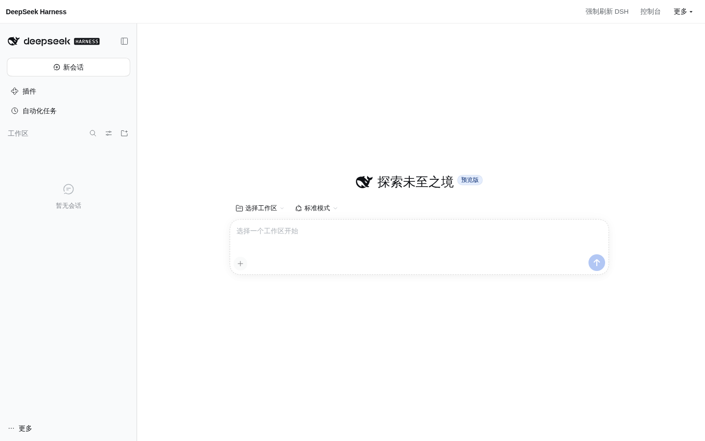
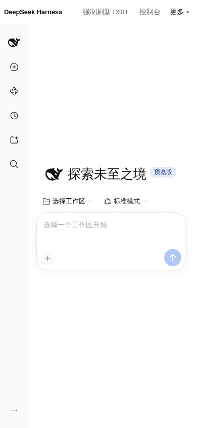

# DeepSeek Harness for fnOS

将 DeepSeek 官方 **dsh Web UI** 打包为飞牛 fnOS 的 FPK 应用，目标平台 fnOS x86_64。FPK 随包携带 `@deepseek-ai/dsh@0.2.1-rc.2` 作为首次安装及离线兜底核心；后续核心可独立安装到应用私有数据目录，管理入口不变。

## 界面预览

应用窗口（首次安装后未选工作区的初始状态；顶部为应用自己的导航栏）：



移动端同一界面（手机飞牛 App 内经 fnOS 应用路径转发，无需直连局域网端口）：



## 下载与安装

安装包发布在 [Releases](https://github.com/upcyan/PowerHarness/releases)，每个版本附一个 `dsh-fnos-<版本>.fpk`。请选标有 Latest 的最新版本，下载后按 release 正文里的 SHA-256 核对：

```sh
sha256sum dsh-fnos-<版本>.fpk
```

> 请使用 [0.3.95](https://github.com/upcyan/PowerHarness/releases/tag/v0.3.95) 或更新版本。旧版 `0.3.84`、`0.3.85` 的 MCP 依赖存在已知 OAuth 凭据校验漏洞，不建议安装。

安装步骤：

1. 从 Releases 下载 `.fpk` 并核对哈希。
2. 打开 fnOS **应用中心**，「手动安装」选择该文件（部分版本在应用中心右上角设置里提供入口）。
3. 安装后点击桌面的 **DeepSeek Harness** 图标启动。首次启动会初始化数据目录并可能重启一次核心，页面显示「自动维护模式，请等待」属正常现象。

升级注意：

- 版本号必须递增，fnOS 才识别为更新；同版本重装可能被拒绝。
- 升级会短暂停止核心，进行中的对话会中断。**建议先在「备份与恢复」里做一次手动备份**，尤其是在装过第三方插件或改过 `cordis.patch.yml` 之后。
- 新核心启动失败时应用会回到上一版可用核心并显示「待确认横幅」，由你决定是否恢复数据，不会自动覆盖。
- 回退旧版同样需递增版本号；低版本可能被 fnOS 拒绝，此时需先卸载（会清除应用数据）。

> ⚠️ 本应用以应用专用用户在 NAS 上执行 DSH 的文件与命令操作，并提供一个仅限 fnOS 管理员访问的 Web 入口。**只从本仓库的 Releases 下载**，不要使用来源不明的 FPK。

## 打开方式

安装启动后点击 fnOS 桌面的图标。电脑通过 NAS IPv4 访问走 `https://NAS_IP:3080`；手机飞牛 App 和主机名入口经 fnOS 已认证的应用路径 `/app/dsh-fnos/dsh/` 转发，不需要手机直连局域网地址或独立端口。窗口顶部是应用自己的导航栏（**强制刷新 DSH** / **控制台**），主体是完整 dsh Web UI。首次进入后到 **Settings → Models** 设置 DeepSeek API Key 并选择工作区。

命令和文件操作以应用专用用户身份执行，初始工作区在应用私有数据目录。要访问其他 NAS 目录，在 fnOS 应用中心为 DeepSeek Harness 授予目录权限并重启应用；授权目录会在工作区的 **fnOS 授权目录** 里出现快捷入口，内容不会复制进备份。

局域网独立 HTTPS 入口使用应用生成的本机证书。全新 NAS 或新浏览器首次经桌面图标进入可能看到空白：先在**新标签页**打开应用地址完成证书信任（高级 → 继续前往），再回来点 **重新检查**。

## 管理与备份

点窗口顶部的 **控制台** 打开管理页：概览（运行状态、重启、端口）、核心与扩展（DSH 版本、插件、npm 源）、数据与权限（配置档、备份、目录、容器）、诊断（三类日志、网络调试）。核心更新先装入独立版本目录、备份数据、试运行新核心；失败自动回到旧核心并等待你决定是否恢复数据。备份包含应用私有的设置、会话和工作区，不复制外部授权目录；卸载清除数据或磁盘故障会同时丢失备份。

完整的操作说明、备份策略、插件与网络调试细节见 **[docs/USAGE.md](docs/USAGE.md)**。

## 构建 FPK

在 Linux x86_64 构建机装好 Node.js 24、npm、Python 3、支持静态 libc 的 C 编译器和官方 `fnpack`，然后：

```sh
bash scripts/build-linux.sh                 # 用 fnos/manifest 里的版本原样打包
bash scripts/build-linux.sh --bump patch    # 打包前自增版本（patch|minor|major）
bash scripts/build-linux.sh --set 1.0.0     # 指定版本
```

构建在调用 `fnpack` 前强制执行依赖审计与 MCP/DSH 桥接兼容检查，失败即退出、不推进 manifest。版本只在打包成功后写回。

**不要在有本应用实例运行的机器上跑这个脚本**：它会启动一份 supervisor 并把 `/opt/dsh/home` 指向自己的数据目录，可能改指生产桥接。

依赖、内置插件打包、Windows 重打包、图标生成和验收范围见 **[docs/BUILD.md](docs/BUILD.md)**；架构与安全边界见 [docs/design.md](docs/design.md)；核心解耦边界见 [docs/decoupled-runtime.md](docs/decoupled-runtime.md)。

## 许可证范围

PowerHarness 原创且维护者有权授权的包装器、管理与构建代码采用 [MIT](<LICENSE>)；完整边界见[许可证与分发范围](<LICENSING.md>)。第三方 runtime、可选插件及依赖保留原版权和各自条款（MIT、Apache、AGPL、LGPL 等），不能把整个 FPK 统一解释为 MIT。后续候选包同时保留本项目声明与各组件声明；选择 MIT 不等于已完成全部再分发义务，发行者仍须按实际载荷逐项核对。

## 更多文档

- [docs/USAGE.md](docs/USAGE.md) — 使用、管理、备份与故障恢复
- [docs/BUILD.md](docs/BUILD.md) — 构建、内置插件、图标与验收
- [docs/design.md](docs/design.md) — 架构与安全边界
- [docs/decoupled-runtime.md](docs/decoupled-runtime.md) — FPK 与核心解耦
- [docs/MAINTENANCE.md](docs/MAINTENANCE.md) — 维护者专用：安全部署与公开构建上下文
